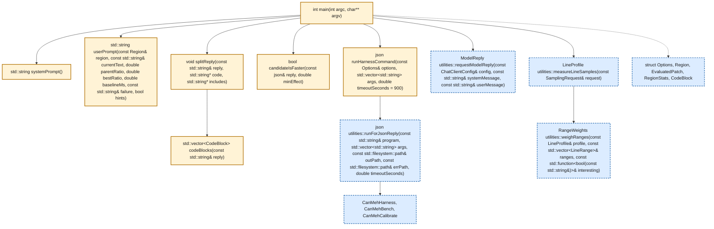
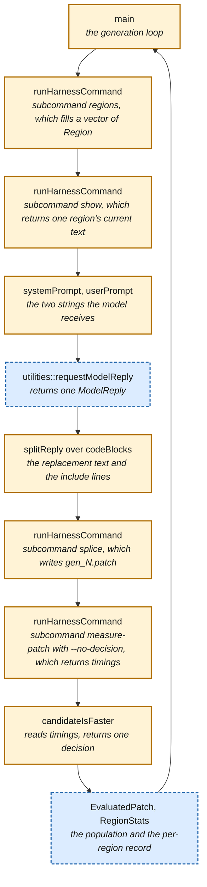

# Technical reference

[Back to README](../README.md) · [Assignment requirements](assignment.md) · [Cluster setup](cluster.md)

- [Architecture and search functions](#architecture)
- [Measurement and raw timings](#measurement)
- [Sample data](#sample-data)
- [Defaults](#defaults)
- [Design rationale](#design-rationale)
- [Glossary](#glossary)

## Architecture

The project has six programs. Five are provided tools; `CanMehSearch` is the
student search loop, implemented in `src/Search.cpp` in this checkout.

| Program | Responsibility |
|---|---|
| `CanMehCalibrate` | Measure the calibration pairs |
| `CanMehHarness` | Copy the SDK, splice patches, build candidate libraries, and invoke measurements |
| `CanMehSearch` | Choose candidates, call the model, apply the decision rule, and log results |
| `CanMehBench` | Load both libraries, check correctness, and time decodes |
| `CanMehDataGenerator` | Write the four activity files during the build |
| `CanMehDecodeForSampler` | Decode one library repeatedly while `sample` or `perf` records source lines |

The original starter leaves seven function bodies empty in `src/Search.cpp`.
That is the only implementation file students are expected to edit.

Descriptions of `CanMehSearch` define the required search behavior. The files under
`--out`, the [population](#population), the profiling pass before the first
[generation](#generation) and the `null_ok` check are all described in this
document because your implementation has to produce them. The other five
programs arrive complete, so a sentence about `CanMehHarness`, `CanMehBench`,
`CanMehCalibrate`, `CanMehDataGenerator` or `CanMehDecodeForSampler` describes
what you can rely on.

In both diagrams below, **a solid amber box is code you write** and **a dashed
blue box arrives complete**. The arrows are calls. A Markdown reader that draws
Mermaid diagrams, such as GitHub, is where you see those two colors; reading
this file as text, you get the same split from the `class ... write` and
`class ... provided` lines at the end of each diagram, which name the
identifiers in each group. The first diagram shows the seven functions
`src/Search.cpp` declares and the four provided functions they call:

<details>
<summary>Show call diagram</summary>



</details>

The five structs are declared for you, so the fields your loop records are
already named. The original starter supplies seven empty function bodies. `candidateIsFaster`
receives the JSON
object `measure-patch` returned and answers whether the library linked from that
candidate's patched tree decoded faster than the reference library by the margin
your rule requires. `CanMehSearch` computes the comparison with the
[parent patch](#parent-patch) separately, as [`improved_on_parent`](#improved_on_parent). Under `--no-decision` that object holds [`timings`](#timings)
and no statistic, so your version computes every number it reads.

The same functions in the order one generation calls them:

<details>
<summary>Show call diagram</summary>



</details>

The search loop calls `CanMehHarness` for patching, compiling, and timing.

`runHarnessCommand` is the one function every step goes through, so implement
it first: it builds an argument vector, calls
`utilities::runForJsonReply`, and returns the one JSON object the subcommand
printed. `CanMehHarness` answers each invocation with exactly one JSON object
and keeps its state in the [work directory](#work-directory).

Output from `measure-patch` lands in two places, and a reader who looks in the
wrong one finds nothing. When `measure-patch` refuses a candidate it names the
`stage` that refused it in the JSON object `runHarnessCommand` returns. The
per-repetition numbers go to a Google Benchmark report at
`scratch/gb/proc-NN.json`, one per process. Read the JSON object for why a
candidate was refused, and that report for anything the
`timings` object leaves out.

`--sample-seconds` adds a second build and a fourth binary. `CanMehHarness
sampling-library` compiles the baseline tree into `obj-sampling/` with `-g`,
the compiler flag that makes the compiler emit debug line tables, which is what
lets a sampler name a source line rather than an address, and links
`libfit_sampling` from those objects. `CanMehDecodeForSampler` then opens that
one library and [decodes](#decode) repeatedly under Google Benchmark while
`utilities::measureLineSamples` runs the platform sampler over that process,
and `utilities::weighRanges` sums the per-line counts into region ranges.
`src/utilities/LineSamples.hpp` implements both of those functions already.
This whole path times `libfit_sampling` alone, and `CanMehSearch` finishes all
of it before the first generation, because a sampler running beside a measurement widens
the spread of the per-repetition decode times.

## Measurement

The harness runs `CanMehBench` to check correctness and collect raw timings.
Your decision rule computes its own statistics from those timings.

`CanMehHarness init` compiles the SDK copy once and links those objects twice,
into two shared libraries that export the workload's C entry points, and
`CanMehBench` loads both libraries into one process with `RTLD_LOCAL`, so the two sets of `fit::` symbols and static
profile tables stay separate. Google Benchmark then interleaves the repetitions of
the two benchmark functions, so `CanMehBench` runs the reference and the candidate
against the same page cache, the same clock and the same machine conditions.

`CanMehBench` checks correctness before timing anything. The candidate must
fold every decoded field value to the same checksum as the reference, twice
over, must answer the profile lookups exactly as the reference answers them
across their whole input domain, and must not use threads.

Which test `measure-patch` runs depends on `--repeat`, and both tests read the
per-repetition times Google Benchmark reported. At `--repeat 1` it
runs a [permutation test](#permutation-test) over the per-repetition
timings inside that one [process](#process). At `--repeat 2` or more
it runs a
[sign-flip test](#sign-flip-test) over the per-process log-ratios instead,
which is the path `--repeat 10` takes and therefore the path your results come
from.  `CanMehHarness
init` links a second library from the reference library's objects and divides
that second library's median decode time by the reference library's, which is
the null run, and reports `null_ok` false when that quotient differs from 1.000
by two percent or more, between two libraries built from
identical code. `CanMehHarness init` reads only that quotient and never p,
because under the null hypothesis of no difference p is uniform, so one run in
twenty reports p below 0.05 on the quietest node.

### Why use ten processes?

The exact two-sided sign-flip test has a minimum p-value of `2 / 2^N` for
`N` processes. At `--repeat 5`, the minimum is 0.0625, so a `p < 0.01`
criterion cannot pass. Eight processes can reach 0.0078; ten give finer
resolution, with a minimum of `2 / 1024`, about 0.00195. Passing depends on the
observed log-ratios, not a fixed allowance for disagreeing processes.

Use `--repeat 10` for the documented workflow. The harness's `ratio_spread`
threshold was calibrated at ten processes. Report the count you use.

### Raw timing output

`measure-patch` and `measure-pair` both print a `timings` object
holding every per-repetition number Google Benchmark reported, together with the
facts `CanMehHarness` records about each process: its index, whether
`CanMehHarness` swapped the [slots](#slot), the path of the report `CanMehBench`
wrote under `scratch/gb`, the load averages Google Benchmark put in that
report's `context` and the per-repetition
`candidate_ns`, `reference_ns`, the two processor-time series and the two
iteration counts. Every statistic `measure-patch` prints is computable from that
object, which is what lets you check a statistic rather than trust it.

Here is one complete `timings` object, which `measure-pair --no-decision` printed
over the `null` calibration pair at `--repeat 2 --repetitions 3`. The two
libraries of that pair perform the same number of [work units](#work-unit), so no number
below tells you anything about the SDK. Each `report` value is an absolute
path, abbreviated here:

<details>
<summary>Show a complete timing JSON example</summary>

```json
{
  "ok": true,
  "processes": 2,
  "repetitions": 3,
  "swapped_processes": 1,
  "timings": {
    "unit": "ns",
    "clock": "real_time",
    "min_time": "0.25s",
    "repetitions_requested": 3,
    "ragged": false,
    "process": [
      {
        "index": 0,
        "swapped": false,
        "report": ".../calibration/null/scratch/gb/proc-00.json",
        "load_avg": [9.75928, 7.66357, 5.21631],
        "candidate_ns": [6775919.918664822, 6870977.114886045, 6893490.194616949],
        "reference_ns": [6757401.961687149, 6803538.412878326, 6813479.587435722],
        "candidate_cpu_ns": [6772156.862745094, 6867176.470588243, 6888843.137254903],
        "reference_cpu_ns": [6752882.352941173, 6799450.980392158, 6810098.039215696],
        "candidate_iterations": [51, 51, 51],
        "reference_iterations": [51, 51, 51]
      },
      {
        "index": 1,
        "swapped": true,
        "report": ".../calibration/null/scratch/gb/proc-01.json",
        "load_avg": [9.75928, 7.66357, 5.21631],
        "candidate_ns": [6809955.061066384, 6856538.391872948, 6846240.192067389],
        "reference_ns": [6847183.317877352, 6873385.841026902, 6823513.321578503],
        "candidate_cpu_ns": [6806156.862745101, 6852509.803921567, 6841960.78431373],
        "reference_cpu_ns": [6843100.0, 6869000.000000005, 6819340.0],
        "candidate_iterations": [51, 51, 51],
        "reference_iterations": [50, 50, 50]
      }
    ]
  }
}
```

</details>

`timings.process` holds one entry per process, so its length is the value you
passed to `--repeat`. Each series inside one entry holds one value per
repetition, so its length is the value you passed to `--repetitions`.
`CanMehHarness` requires at least three repetitions in each series. Below three
it prints a three-key object -- `"ok": false`, `"stage": "run"` and the error
`too few repetitions came back from the benchmark` -- so a parser has to read
`ok` before it reaches for `timings`.

The five fields outside `process`:

- `unit` is `ns`, so every number in every series is nanoseconds.
- `clock` is `real_time`, naming which of Google Benchmark's two clocks
  `candidate_ns` and `reference_ns` report.
- `min_time` is the `--benchmark_min_time` `CanMehBench` passed to Google
  Benchmark, which `CanMehHarness` reads from `meta.json` and defaults to
  `0.25s`.
- `repetitions_requested` is what you asked for, so your rule can detect a
  process that returned fewer.
- `ragged` is true when the series differ in length, either between processes
  or between the two series inside one process. A rule that
  pairs process 0's third repetition with process 1's third repetition has to
  read `ragged` before it does so.

The ten fields inside one `process` entry:

- `index` numbers the processes in the order `CanMehHarness` ran them.
- `swapped` is true when `CanMehHarness` placed the candidate library in the
  `--base` slot, so that process loaded the candidate first. `CanMehHarness`
  alternates, and `swapped_processes` beside `timings` counts how many of the
  processes swapped.
- `report` names the Google Benchmark report `CanMehBench` wrote, so you can
  read that report directly for anything this object omits.
- `load_avg` holds the three load averages Google Benchmark recorded in its
  report's `context`, over one, five and fifteen minutes.
- `candidate_ns` and `reference_ns` hold Google Benchmark's `real_time` per
  repetition. **Each value is a mean over that repetition's decodes, not one
  decode.** A rule that ignores the iteration count mistakes Google
  Benchmark's averaging for a quiet machine.
- `candidate_cpu_ns` and `reference_cpu_ns` hold the matching `cpu_time`
  series. Dividing a candidate library's processor time by its wall-clock time is how
  you notice a candidate that started threads.
  - `candidate_iterations` and `reference_iterations` hold the decode counts
  Google Benchmark chose. **Do not divide by these.** `candidate_ns` is already
  nanoseconds per decode, not a repetition total: in the object printed above over the `null` pair, 51
  decodes of 6.8 ms fill the 0.25 s `min_time`, and [`score_ms`](#score_ms) is the median of
  `candidate_ns` with no division anywhere. What the counts tell you is how
  deeply Google Benchmark averaged each repetition, and **the two counts need
  not agree**: process 1 above decoded 51 times per candidate repetition and 50
  times per reference repetition, because Google Benchmark sizes each of the two
  benchmark functions separately. So the candidate series and the reference
  series are comparable as they stand, but one may be the quieter average of the
  two, and a rule that weights the two series equally assumes both averaged
  equally deeply.

`measure-patch --no-decision` and `measure-pair --no-decision` print exactly the
five keys the object above shows: `ok`, `processes`, `repetitions`,
`swapped_processes` and the `timings` object. Your loop runs
`measure-patch` that way, so your code computes every statistic in your result
from `timings`. `measure-pair` times the two libraries
a work directory already holds, applying no patch and rebuilding nothing, which
is how `CanMehCalibrate` measures a calibration pair: a calibration pair has no
SDK tree for `measure-patch` to patch.

We deliberately record no reference numbers in this file: in Phase 0 you
produce the numbers this document refuses to give you.

Read [Sample data](reference.md#sample-data) for what the four activity files hold and for the four
numbers to report about them.

`CanMehBench` passes the data directory to each library's
`canmehLoadDataFiles`, and each library reads the four files itself, so each
library decodes the bytes that library loaded.

`CanMehBench` compares the candidate's answers with the reference's, so a
candidate that rewrites the correctness [oracle](#oracle) disagrees with the reference and
loses.

## Sample data

`CanMehDataGenerator` writes the four files, and CMake runs
`CanMehDataGenerator` as a build step, so `cmake --build build -j` leaves them in
`build/data` and compiles that path into `CanMehHarness` as the default for
`--data`. You invoke `CanMehDataGenerator` yourself only to write the files
somewhere else: it takes the output directory as its one argument and declares no
options, so it answers no `--help`.

The four are `intervals.fit`, `long_run.fit`, `ride.fit` and `treadmill.fit`,
about 900 kB together, and they are synthetic rather than recorded: each file
holds a session of the records a watch or a bike computer writes, with heart
rate, power, speed, distance, altitude and position varying over a sine.
`CanMehDataGenerator` encodes each file by calling the SDK's own encoder, so a
candidate decodes bytes the SDK itself wrote. One decode
reads all four files.

An Apple laptop and an `xcnc` node write the same bytes, which we established by
comparing the MD5 sum and the byte count of each of the four files after a fresh
configure on each platform. Two measures hold that true, and the build already
applies both: `CanMehDataGenerator` rounds every value it derives from a sine
rather than truncating it, and `CMakeLists.txt` compiles `CanMehDataGenerator`
with `-ffp-contract=off`. A compiler that fuses a multiply and an add rounds once
where another compiler rounds twice, and that one difference moved one heart-rate
byte of `long_run.fit` between the two platforms until those two measures went
in. So your [ratio](#ratio) and a classmate's divide times measured over
identical input, and the checksum below is what establishes that.

`CanMehBench` writes that data's checksum, byte count, message count and field
count to its stderr, which `CanMehHarness` leaves in `<work>/scratch/bench.err`,
once the load, data, correctness, profile-digest and processor-time checks have
all accepted. Read the four numbers there and report them with your results, as
the [Evidence](assignment.md#evidence) group lists, because two sets of timings
are comparable only if the two decodes read the same bytes.

## Defaults

The main harness defaults are:

| Option | Default | Meaning |
|---|---|---|
| `--repeat` | **1** | Independent benchmark processes; use **10** for this workflow |
| `--repetitions` | 9 | Repetitions inside each process |
| `--null-repetitions` | 9 | Repetitions for the initialization null check |
| `--min-time` | `0.25s` | Google Benchmark's minimum time per repetition |
| `--max-lines` | 250 | Region length limit; the default index contains 5,514 regions |
| `--opt` | `-O2` | SDK compiler optimization flags |
| `--cxxstd` | `-std=c++17` | SDK language-standard flag |
| `--min-effect` | 0.02 | Effect floor for `measure-patch` and `measure-pair` verdicts |

At `--repeat 1`, the harness uses a within-process permutation test. Earlier
measurements called an inert patch significant about two times in five with
that setting. Set the process count explicitly and calibrate your own rule.
With `--no-decision`, the harness supplies no verdict: your rule applies its
own effect floor, expected to be 0.02.

The main search defaults are:

| Option | Default | Meaning |
|---|---|---|
| `--generations` | 40 | Maximum generation count |
| `--population` | 6 | Maximum retained population |
| `--uniform-share` | 0.1 | Uniform share of draws outside the best-gain branch |
| `--sample-seconds` | 0 | No initial profiling pass |
| `--prompt-hints` | Off | Add three optimization-hint sentences when enabled |
| `--seed` | 1 | Search random seed |
| `--region-files` | Empty | Every indexed file is reachable |
| `--min-effect` | 0.02 | The current rule's minimum fractional reduction in time |

`--region-files` accepts one comma-separated string, for example
`--region-files fit_mesg.cpp,fit_field.cpp`. Pass `--llm-api-key-file` for the
default endpoint; [Model endpoint](cluster.md#model-endpoint) explains the setup.
Use `--help` on a tool or subcommand for its complete, generated option list.

## Design rationale

We tried every simpler design, and each one reported a speedup for an
inert patch:

- timing one process per build and taking the minimum of the repeats
- reading the first evaluation of a session, before the machine has settled
- running the reference before the candidate every time, which turns drift over
  the session into an apparent gain
- interleaving paired runs and taking a median of the per-pair ratios, which
  lowered the speedup those designs reported for an inert patch without bringing
  it to 1.000

Only a permutation test on the per-repetition timings rejected the
inert patch all four of those designs called faster. At the
speedups those four designs reported for an inert patch, a loop built on any of
them would admit a false positive inside ten generations, and no real
improvement displaces that false positive afterward.

One problem remains even with the permutation test. At p < 0.01, one test per
generation produces a false positive roughly every hundred generations, so
`CanMehSearch` re-measures any candidate that passes and requires the second
measurement to agree.

## Glossary

### decision rule

the first of the two programs you write: the code that reads the
`timings` object `measure-patch --no-decision` printed and answers
whether that candidate decoded faster. Its shape is yours to choose, whether a
function inside your loop, a separate program or a shell pipeline, and Phase 0
is where you establish what it does before you spend a model budget on it.

### work directory

the directory `--work` names. `CanMehHarness init`
creates it, and every later subcommand reads it. `init` writes `meta.json`,
which records the compiler, the paths and the `--repeat` and `min_time`
settings every later `measure-patch` inherits; copies the SDK into `baseline/` and
again into `tree/`; compiles `tree/` into `obj/`; and links `libfit_ref` from
those objects. `measure-patch` splices a patch into `tree/`, recompiles only the
objects the patch made stale, relinks `libfit_cand` and runs `CanMehBench`
over the two libraries, writing the Google Benchmark reports and each child
process's output into `scratch/`. `CanMehHarness sampling-library` adds
`obj-sampling/` and a third library, `libfit_sampling`, compiled with debug
line tables. `CanMehHarness` links `libfit_ref` once, during `init`. Every later
`measure-patch` compares against that same reference library, measuring it
again alongside the candidate. The reference code is fixed; its measured
time can vary between measurements. One work directory holds one
tree and one pair of libraries, so two searches running at the same time
need two work directories.

### splice

the step that turns your replacement for one [region](#region) into a patch.
`CanMehHarness splice` reads that region's current text, puts your replacement
where it was, and writes a unified diff of the whole tree to the file `--out`
names. Given `--patch` it splices onto that patch rather than onto the
unmodified baseline, which is why a child's diff contains every rewrite above
it. `splice` ignores an `#include` written inside the replacement text, so
include lines go in the file `--includes` names instead.

### region

ONE function body that `CanMehHarness regions` found by matching braces,
identified by an `id` that indexes the full list. `file` and `label` are
reported beside the id so that a log is readable, and so that you can re-find a
region after a patch moved its line numbers, but `show` and `splice` resolve the
id alone. `--max-lines` bounds how long a region may be, and changing it
renumbers every id, because the id is a position in that list rather than a
field stored in the region.

### decode

one call to `canmehDecode`, and the unit `CanMehBench` times
in. `canmehDecode` runs the SDK's decoder over every activity file
`canmehLoadDataFiles` read, in that one call, and folds every field value it
reads into a 64-bit digest. So one decode reads the whole corpus, roughly 900 kB
across four files, rather than one file or one message. Google Benchmark reports
the mean duration of one decode as `real_time`, Google Benchmark reads
`--benchmark_min_time` to choose how many decodes it averages into each
repetition, and `CanMehHarness init` reports how long one decode takes on your
machine. `canmehDecode` returning zero means the SDK decoder failed to read a
file, and `CanMehBench` refuses the pair at stage `baseline`.

### slot

one of the two libraries `CanMehBench` opens, named by `--base` and
`--cand` on its command line. `CanMehBench` opens the `--base` slot first, which
fixes the address placement and which image's static data the allocator hands out
first. With `--swap`, `CanMehBench` treats the `--base` slot as the candidate.

### role

reference or candidate. `CanMehBench` names each timing series after
the role and runs each oracle over the answers of the library that role names.
`CanMehHarness` alternates the slot from one process to the next while each role
keeps its label, so a difference between the two slots biases half the processes
each way instead of biasing every process the same way.

### stage

the step that rejected a candidate, which `measure-patch` names in the JSON object it
returns and `CanMehSearch` copies into `results.jsonl`. An empty `stage` means
`CanMehBench` timed both libraries' decodes and rejected nothing. [Monitoring a run](cluster.md#monitoring-a-run)
enumerates all seventeen values and says which program emits each one, and a
loop that switches on this field should treat a value it does not recognize as a
rejection rather than as a measurement.

### oracle

a check that decides whether a candidate is acceptable at all,
and that `CanMehBench` runs before it times anything. `CanMehBench` runs three
checks on what the two libraries answer, and before all three it rejects a
candidate at stage `load` as soon as `dlsym` fails to return any one of the six
entry points,
which a changed signature causes.
At the decoded-value check `CanMehBench` requires both libraries to fold the
four activity files to the same 64-bit digest, twice each. The profile digest
folds what the three profile lookups answer for every message number from 0 to
65535, and for every field number from 0 to 255 of each message number the
profile answers, so `CanMehBench` rejects a lookup table that is correct for the
message numbers the data happens to contain and wrong above them. The threading
check rejects a candidate whose processor time over one decode exceeds 1.15
times the wall-clock time, because `std::clock` counts the processor time of
every thread in the process.

### null run

the measurement `CanMehHarness init` takes last: the reference library against a
second library linked from the same object files, so whatever the null run
reports is what the machine contributes by itself. `init` reports `null_ok` false when that difference reaches two percent,
when the within-process coefficient of variation reaches 0.25, or when
[`ratio_spread`](#ratio_spread) exceeds 0.25, and every number from a work
directory whose `null_ok` came back false is worthless.

### inert patch

a patch that changes no instruction, usually by adding only
a comment. The compiler emits a byte-identical object file, so the true speedup
is exactly 1.000. A rule that reports a speedup for an inert patch is wrong, which makes
the inert patch the negative control for `CanMehHarness` itself.

### ratio

the candidate's median time divided by the reference's median
time. Below 1.0 means the candidate decoded faster. `measure-patch` also prints
`speedup`, which is 1 divided by the ratio. For multiple processes, the harness reports the median of the per-process
ratios. The current student rule instead divides the median of the candidate
process medians by the median of the reference process medians. These
aggregations can differ. Under `--no-decision`, compute your chosen statistic
from `timings` and calibrate that same statistic.

### ratio_spread

the largest per-process ratio minus the smallest, across
the processes `--repeat` asked for. `ratio_spread` reports how far the processes
disagree, which takes a statistic computed across processes. `CanMehHarness`
computes `ratio_spread` for the null check `init` runs.

### process

one invocation of `CanMehBench`, in the sense the operating system uses the
word. `--repeat N` makes `measure-patch` spawn N of them one after another, and
each one opens both libraries, times both their decodes and writes
one Google Benchmark report under `scratch/gb`, so N processes produce N
ratios from one measurement. Everywhere this document says process it
means this.

### permutation test

the test `measure-patch` runs at `--repeat 1`. It pools the candidate's and the
reference's per-repetition times from that one process, reshuffles which label
each time was recorded under many times over, and counts how often a reshuffle
separates the two labels at least as far as the real labelling did. That
fraction is the p-value.

### sign-flip test

the test `measure-patch` runs whenever `--repeat` is greater than 1. `--repeat N`
makes `measure-patch` spawn N processes, and each one produces its
own ratio, so N ratios come back from one measurement. The test takes
the natural logarithm of each, which makes a process where the candidate decoded
faster a negative number and one where it decoded slower a positive one. If the
two libraries decode at the same speed, each of those N signs is equally likely
either way, so `measure-patch` enumerates all 2^N assignments of signs and
counts how many give a total at least as far from zero as the observed one. That count divided by 2^N
is the p-value, whose minimum is 2/2^N. The test uses the observed log-ratio
magnitudes as well as their signs; its p-value is not an effect-size estimate.

### generation

one pass of your loop. One generation of `CanMehSearch`
picks a parent patch, picks a region, asks the model to rewrite that region,
writes the replacement text out of the reply to a file, has
`CanMehHarness splice` put that text where the region was and write a diff on
top of the parent's, and then times the decodes of the library linked from the
patched tree, which produces one candidate and one `results.jsonl` record. `--generations N` runs
N of them. Retries can make the API-call count larger than the generation
count; use actual calls when matching control budgets.

### population

the patches `CanMehSearch` keeps between generations, at
most `--population` of them, sorted by ratio with the lowest first.
`CanMehSearch` adds every candidate `measure-patch` measured, then discards the worst
member whenever the population grows past `--population`, so membership means
the candidate compiled and ran rather than that any check accepted it.
`CanMehSearch` picks the next parent by a tournament of two: it draws two
members at random and uses the one with the lower ratio.

### parent patch

the patch one generation rewrites. The model receives the
parent's text of one region, and `CanMehHarness splice` applies the child's
replacement on top of the parent's diff, so a child's patch contains every
rewrite above it.

### lineage

the chain of parents from one candidate back to the unpatched
baseline. A candidate inherits every rewrite in its lineage, which is why a
run can report `significant_at_min_effect` for thirty generations from one
discovery and twenty-nine inheritors. `improved_on_parent` is the field that
separates the discovery from the inheritors.

### improved_on_parent

true when your [decision rule](#decision-rule) accepted the candidate and the
candidate's ratio came out below the parent patch's
ratio. A candidate inherits every rewrite in its [lineage](#lineage), so its
ratio measures the accumulated patch, and this field is what reports whether
this one generation's own rewrite moved the number.
`CanMehSearch` credits a region's largest improvement and counts a region's
acceptances on this field rather than on `significant`, because
crediting a region for a ratio that moved by run-to-run variance alone would
send every later draw to that region.

### retained

kept in the population at the end of a generation. `CanMehSearch`
retains every candidate `measure-patch` measured, whatever your rule decided, so
`best_retained_speedup` in `credits.csv` can exceed `best_confirmed_speedup`.

### score_ms

the candidate's decode time in milliseconds. At `--repeat 1`
`CanMehHarness` reports the median of that one process's `candidate_ns`; above
`--repeat 1` it reports the median over processes of each process's own
median. `reference_ms` is the same number for the reference library.
`--no-decision` withholds both.

### candidate_cv

the coefficient of variation of one process's
`candidate_ns` repetitions, meaning that series' standard deviation divided by
its mean, and above `--repeat 1` the largest such value
among the processes rather than an average of them. A single noisy process
therefore moves `candidate_cv` however quiet the others were, which is why
`CanMehHarness` reads `ratio_spread` instead of `candidate_cv` above
`--repeat 1`.

### confirmed_p

the p-value of the second `measure-patch` `CanMehSearch` runs over
a candidate. `CanMehSearch` runs that second `measure-patch` whenever the first one
reported `significant` or `unstable`, and keeps whichever of the two
measurements reported the higher ratio, so a confirmed candidate records the
less flattering of two measurements. `confirmed_p` is -1 in two cases: the second
`measure-patch` failed, or the first measurement reported `significant` false
and `unstable` false, so `CanMehSearch` stopped after one measurement.

### significant

`significant`, `significant_at_min_effect` and `unstable` are the three
fields in which
`CanMehHarness` states its own verdict. `measure-patch` sets `significant` when the ratio
is below 1.0 and the p-value is below 0.01, so the direction comes from the
ratio and the p-value comes from a two-sided test, which is how a one-sided
claim is assembled here rather than by halving a p-value. `measure-patch` sets
`unstable` when the
measurement is too noisy to decide either way: at `--repeat 1` when the
within-process coefficient of variation passes 0.04, and above `--repeat 1` when
`ratio_spread` passes 0.25, because we calibrated 0.04 against a single process,
and the worst coefficient of variation among several processes is a different
quantity. So `unstable` describes the measurement rather than the candidate, and
`CanMehSearch` measures such a candidate a second time.

`measure-patch` sets `significant_at_min_effect` when `significant` holds and the
improvement reaches `--min-effect`, which defaults to 0.02, and reports
`min_effect` beside it so a result records the floor it was judged against. The
two fields differ because above `--repeat 1` `measure-patch` computes p by
flipping the signs of the per-process log-ratios, a test whose p-value is not an effect-size estimate. Ten processes that agree give the same p for a 0.3 percent difference
as for a 10 percent one, and two search candidates have been called
`significant` at 0.32 and 0.34 percent, with two inert-patch measurements at
0.86 and 1.3 percent. `CanMehHarness init` decides its own null
check from effect size for the same reason.

`--no-decision` withholds all three harness verdict fields. The current
search computes its own versions from raw timings and requires confirmation
before accepting a speedup; it also rejects unstable measurements.

Read them freely to understand what a run did; the prohibition is narrower
than that. What you may not do is present one of them as your result. A
report whose claim rests on `significant` has skipped Phase 0, because
reading a verdict somebody else wrote is not writing a measurement.

### timings

the object `measure-patch` and `measure-pair` print whatever else they
withhold: every number Google Benchmark reported, per process and per
repetition. Your rule reads `timings` and nothing else.

### work unit

the unit of work a calibration library performs, 256 dependent
scattered read-modify-writes over a 16 MiB buffer, larger than the level-two
cache of the machine we measured on.
CMake compiles a work count into each library of a pair, and `canmehMessageCount`
reports that count, so you can see at a glance which pair `CanMehBench` opened.

### true ratio

for a calibration pair, the candidate's work count
divided by the reference's. The quotient is the answer your rule is
estimating, known by construction rather than measured, which is what makes
a calibration pair a calibration rather than another measurement.

### false-positive rate

how often your rule reports a speedup for a
pair whose two work counts are equal. The true ratio there is 1.000, so every
such report is wrong. Report the rate with a confidence interval and the trial count.

### detection threshold

the smallest tested speedup your rule detects in at least nine trials out of
ten. Expressed as a candidate/reference ratio, this is the detected ratio
closest to 1.000. The four faster pairs give four
known effect sizes; report the rate at each one rather than a single number.
Report the threshold itself as a ratio, such as 0.98.

### bias

the ratio your rule reports minus the true ratio, at a known
effect size. A rule can have a low false-positive rate and still report a
number two percent away from the true ratio, and a report that quotes a speedup
is quoting that number.
